# Scripts and when they run

Every check in this repo is a script under `scripts/`. The four CI platforms (GitHub
Actions, Azure Pipelines, GitLab CI, Jenkins) only install tools and call these
scripts, so a local run and a pipeline run do the same thing.

Each section has a picture, then the same flow as a Mermaid diagram that GitHub draws
from text, which is easier to keep up to date when a script changes.

## The map

Who starts each use case, which pipeline runs, and which scripts it calls.

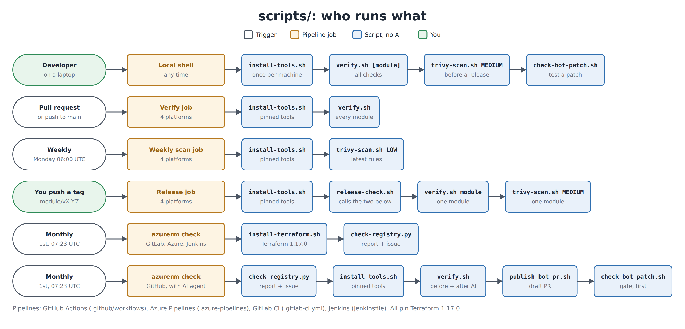

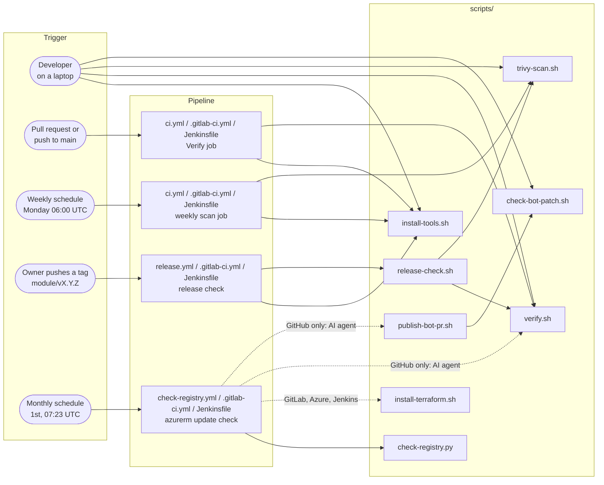

## How the scripts call each other

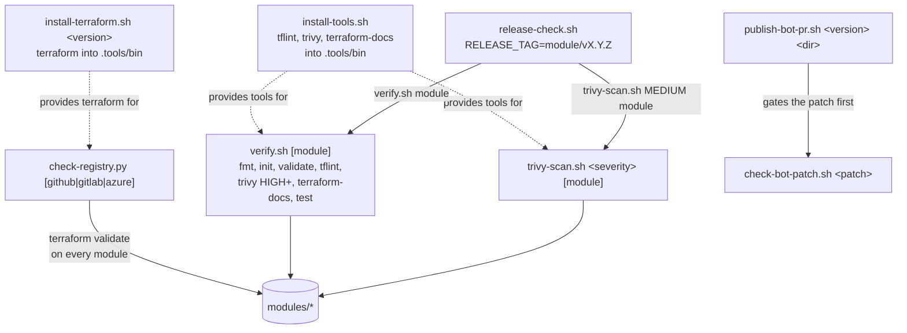

## Use case 1: a developer checks a change

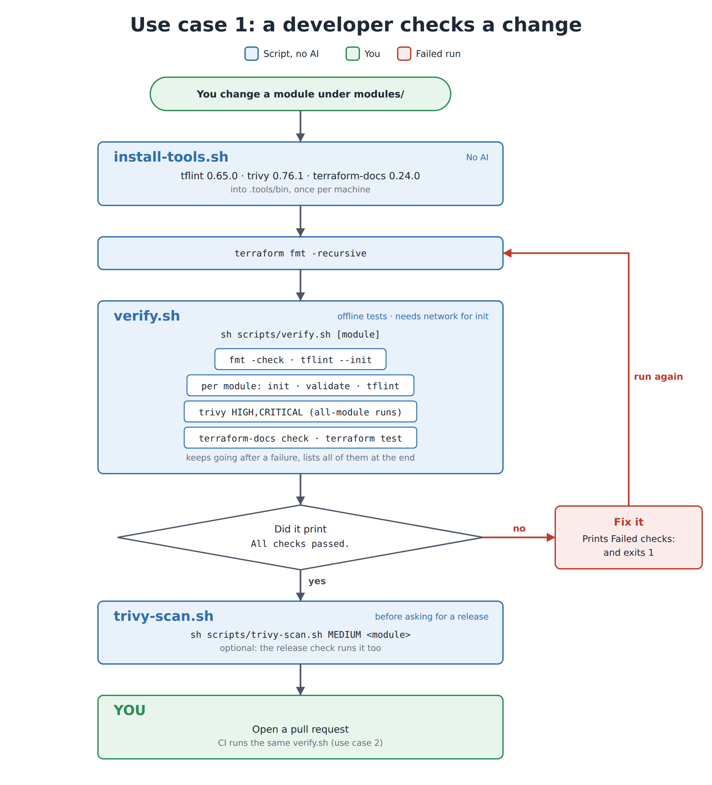

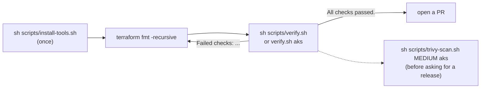

`verify.sh` keeps going after a failure, so one run lists every failing check.

## Use case 2: a pull request or a push to main

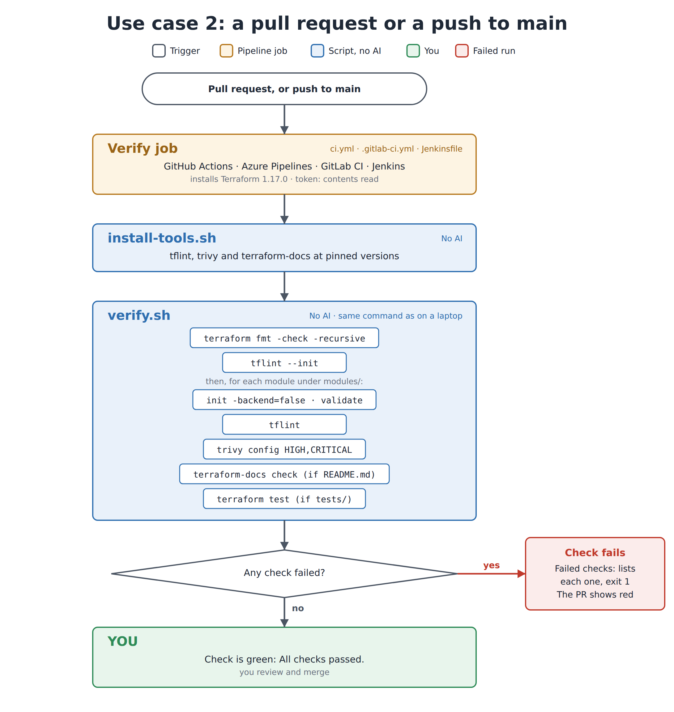

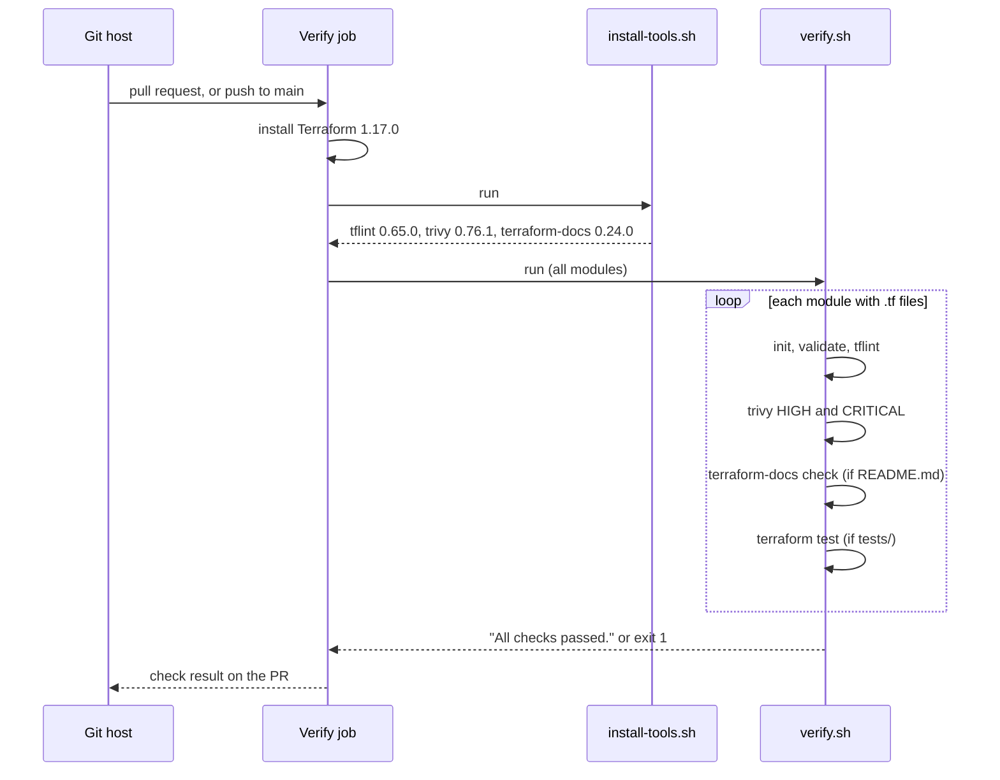

## Use case 3: the weekly security scan

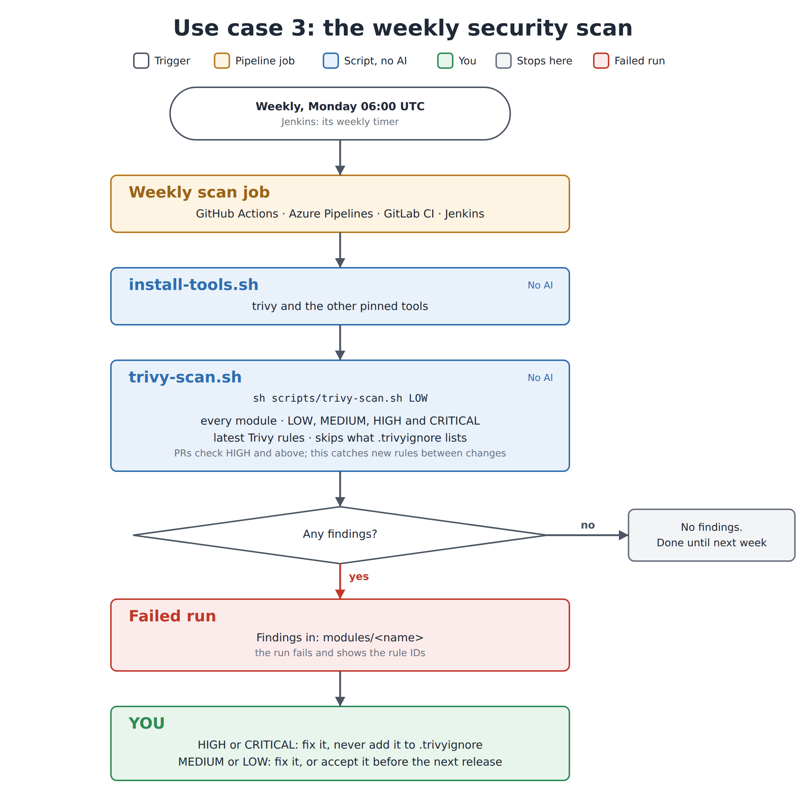

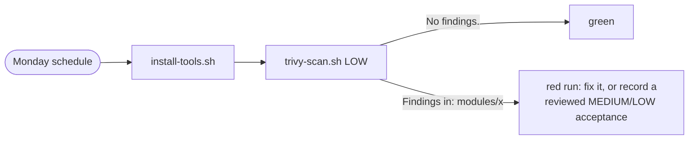

A pull request is checked at HIGH and above. This scan uses the latest Trivy rules at
LOW and above, so it catches new rules that arrive between changes.

## Use case 4: releasing a module

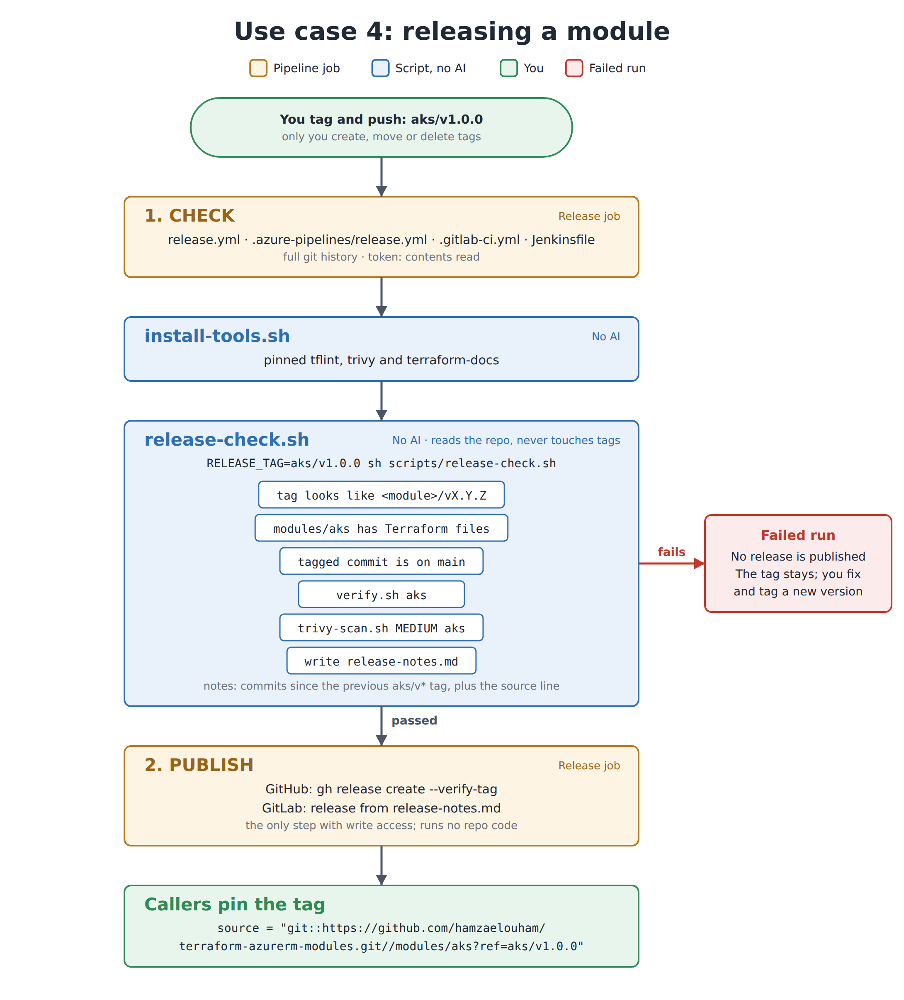

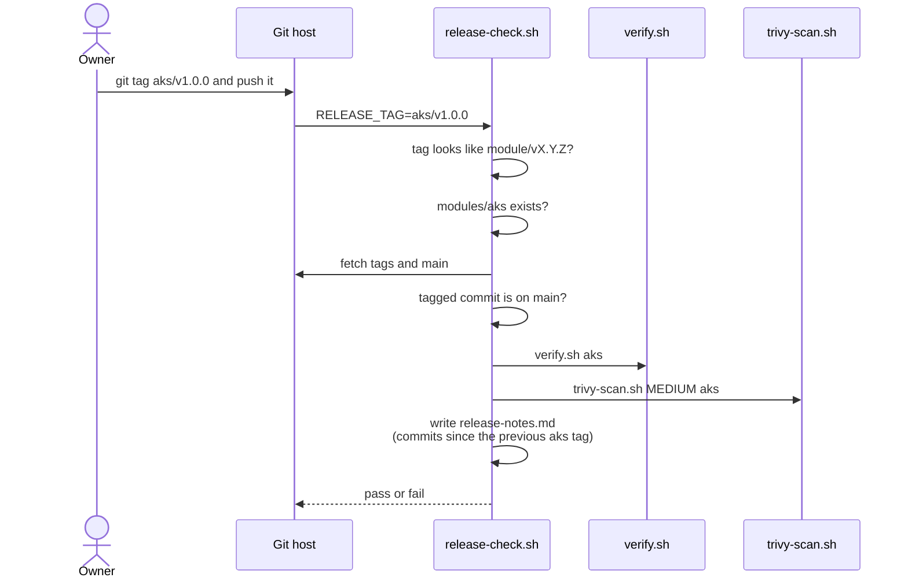

Only the owner creates tags. The script reads the repo and never creates, moves or
deletes a tag.

## Use case 5: the monthly azurerm update check

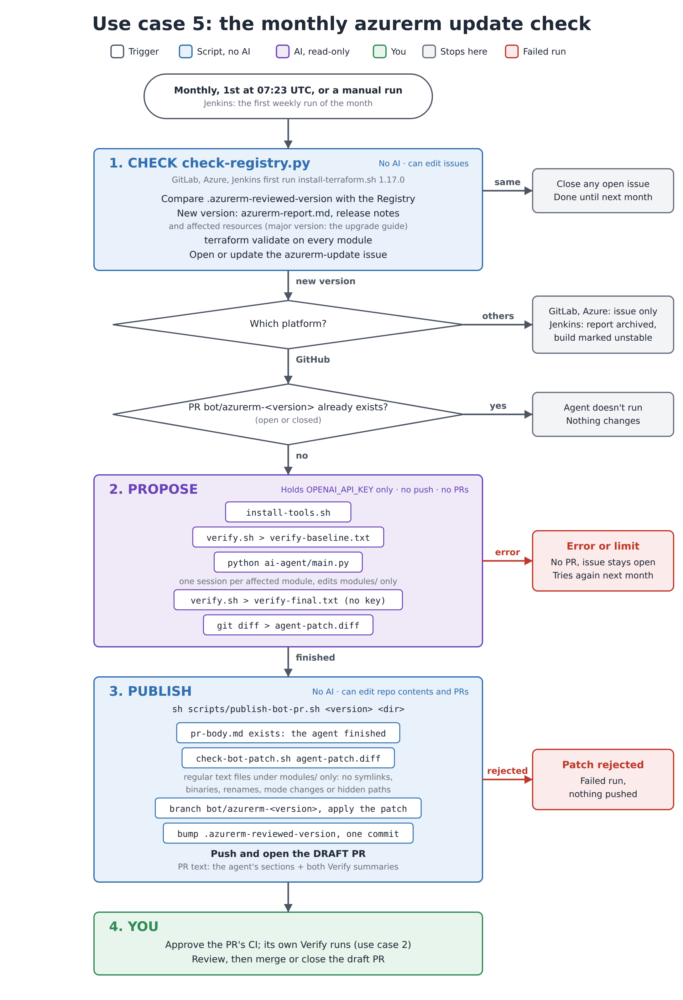

### On GitLab, Azure Pipelines and Jenkins

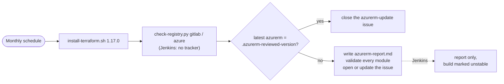

### On GitHub Actions, with the AI agent

Three jobs, each with only the access it needs.

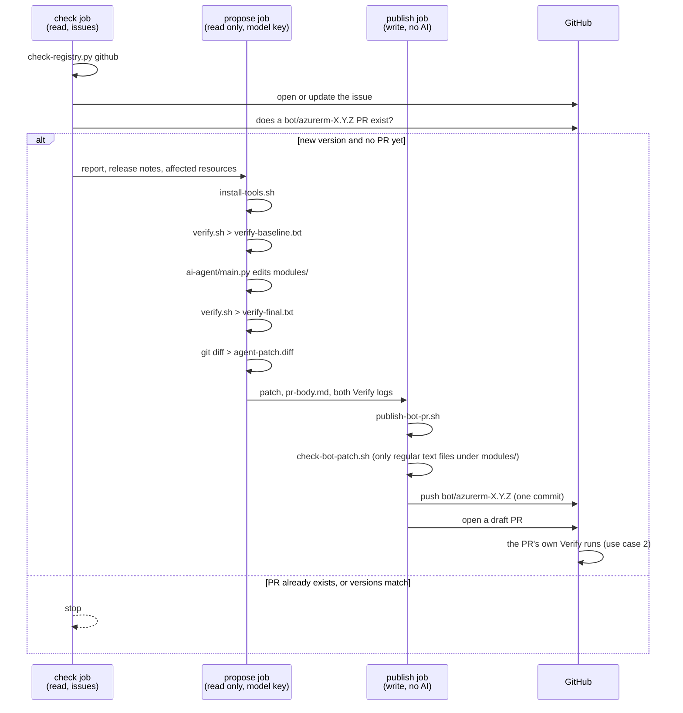

The agent never gets write access, and the job that writes never runs AI or code from
the patch. A person reviews the draft PR and decides whether to merge it.

## Script reference

| Script | Usage | What it does | Fails when | Called by |
|---|---|---|---|---|
| `install-tools.sh` | `sh scripts/install-tools.sh` | Downloads pinned tflint, trivy and terraform-docs into `.tools/bin`. POSIX sh and wget only, so it runs in the `hashicorp/terraform` image | A download fails | Developers; Verify, weekly scan, release and agent jobs on all platforms |
| `install-terraform.sh` | `sh scripts/install-terraform.sh 1.17.0` | Downloads one Terraform version into `.tools/bin`, for jobs with python3 but no Terraform | A download fails | Monthly check on GitLab, Azure Pipelines and Jenkins |
| `verify.sh` | `sh scripts/verify.sh [module]` | For each module: `fmt`, `init`, `validate`, `tflint`, Trivy HIGH+, terraform-docs check, `terraform test`. With a module name, checks only that one and skips Trivy | Any check fails; all failures are listed at the end | Developers; every PR and push to main; `release-check.sh`; the agent job, before and after the agent |
| `trivy-scan.sh` | `sh scripts/trivy-scan.sh <LOW\|MEDIUM\|HIGH\|CRITICAL> [module]` | Trivy at that severity and above, using `.trivyignore` | Any finding at or above the severity | Weekly scan (`LOW`); `release-check.sh` (`MEDIUM`); developers before tagging |
| `release-check.sh` | `RELEASE_TAG=aks/v1.0.0 sh scripts/release-check.sh` | Checks the tag format, that the module exists and that the tag is on main, runs `verify.sh` and `trivy-scan.sh MEDIUM` for that module, then writes `release-notes.md` | Bad tag, missing module, tag not on main, or a failing check | Release pipeline on a pushed `*/v*` tag |
| `check-registry.py` | `python3 scripts/check-registry.py [github\|gitlab\|azure]` | Compares `.azurerm-reviewed-version` with the registry, writes `azurerm-report.md`, release notes and `azurerm-affected.json`, validates every module, and opens, updates or closes one `azurerm-update` issue | Network or API error, or a module no longer validates | Monthly check on all four platforms |
| `check-bot-patch.sh` | `sh scripts/check-bot-patch.sh <patch>` | Gate on the agent's patch: only regular text files under `modules/`; no symlinks, binaries, renames, mode changes or hidden paths. Never applies the patch. An empty patch passes | The patch breaks any of those rules or git can't read it | `publish-bot-pr.sh`; developers testing a patch |
| `publish-bot-pr.sh` | `sh scripts/publish-bot-pr.sh <version> <dir>` | Requires `pr-body.md`, gates and applies the patch, bumps `.azurerm-reviewed-version`, pushes `bot/azurerm-<version>` and opens a draft PR with both Verify summaries | No `pr-body.md` or patch, a rejected patch, or a push or PR error | GitHub `check-registry.yml` publish job only |

Every platform pins Terraform 1.17.0. Tool versions are pinned in `install-tools.sh`.
